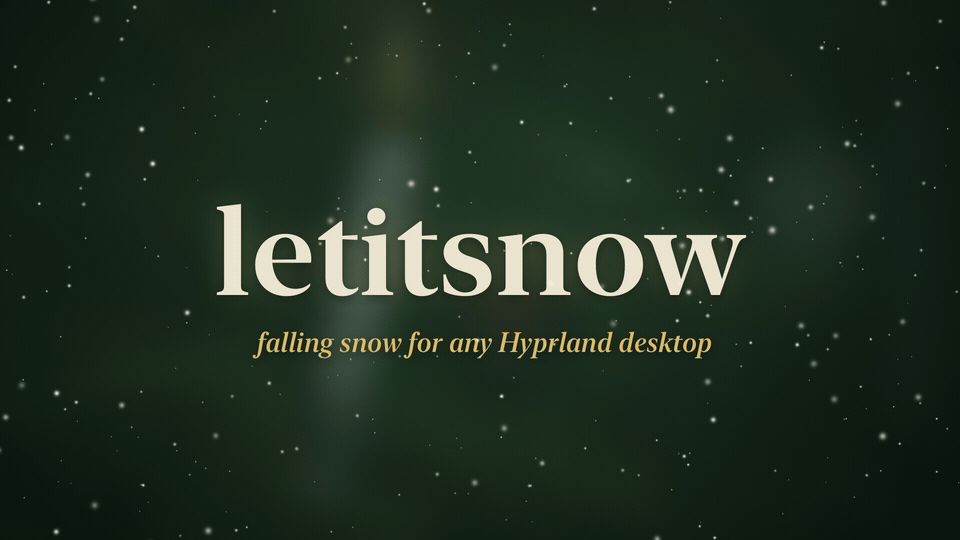
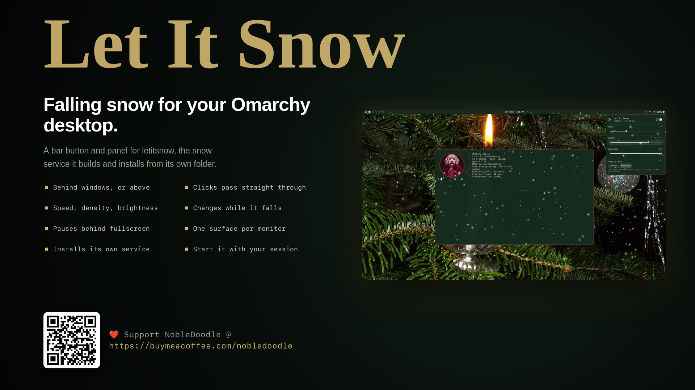

# letitsnow

**Falling snow on your Hyprland desktop.**



Soft, glowing flakes drift down your screen, swaying as they fall. They land
on the wallpaper behind your windows, on the wallpaper with a faint veil of
them over your windows, or on top of everything. Clicks always pass through. One small native program draws the
snow on the GPU, one surface per monitor, and sleeps whenever there is nothing
to show.

This repository is two things:

- **letitsnow**, the user service that draws the snow. It works in any
  Hyprland setup.
- **Let It Snow**, a bar button and panel for Omarchy that starts, stops and
  tunes the snow, and builds and installs the service from this same folder.

## On Omarchy

```bash
omarchy plugin add https://github.com/NobleDoodle/letitsnow --enable
```

Then click the snowflake in the bar and choose **Install** (or press `i`).
Install runs `bin/letitsnow-setup` in Omarchy's terminal, which:

- builds the service from this checkout with makepkg, offline, in a sandbox
  that cannot use sudo and can only read the checkout
- checks the package before pacman sees it: only letitsnow's own files, no
  install script, nothing setuid
- installs it with pacman, which asks for your password
- offers to start the snow now, and to start it with your session

Nothing else is cloned or downloaded, unless a build tool (`base-devel`,
`wayland-protocols`) is missing, and setup asks before installing those.



The panel:

- **Snowflake button**: tinted while it snows. Left click opens the panel,
  right click starts or stops the snow, and the scroll wheel thickens or thins it.
- **Power switch** in the panel header.
- **Speed**, **Density** and **Brightness** sliders. The snow changes as you
  drag.
- **Where it falls**: *Desktop*, *Dynamic* or *Above all* (see [Where it falls](#where-it-falls)).
- **Start with the session**.
- **Install / Update / Remove...** for the service, with a dot on the
  snowflake while an install or update is waiting.

It works from the keyboard too: the arrow keys move and adjust, Enter switches,
and `i` installs or updates. Everything goes through the `letitsnow` command,
so the panel and a terminal always agree.

**Update** with `omarchy plugin update io.github.nobledoodle.letitsnow`. When
that brings a newer service, the snowflake shows a dot and the panel offers
**Update**, which builds it the same way.

**Remove**: **Remove...** at the bottom of the panel stops the snow and
uninstalls the package (it asks before deleting your snow settings). Then
`omarchy plugin remove io.github.nobledoodle.letitsnow`.

## On any other Hyprland setup

You need `wayland`, `libglvnd` (EGL and GLES 2), `wayland-protocols` and a C
compiler, all of which a Hyprland system already has.

```bash
git clone https://github.com/NobleDoodle/letitsnow
cd letitsnow
make install-user          # ~/.local/bin/letitsnow and a systemd user unit
```

Or build a package from the checkout with `cd packaging && makepkg -si`. To
remove a user install, run `make uninstall-user`.

## Use

```bash
letitsnow                      # start the snow
letitsnow stop
letitsnow toggle               # good for a key binding
letitsnow status

letitsnow speed 1.5            # 0.1–5, 1 is the original pace
letitsnow density 2            # 0.1–5, 1 is 240 flakes per 1920×1080
letitsnow opacity 0.6          # 0.05–1, how bright the flakes are
letitsnow layer dynamic        # desktop (default), dynamic or top
letitsnow set speed=0.8 density=3 layer=desktop
letitsnow start --density 2 --layer top
letitsnow reset

letitsnow enable               # start with your session
letitsnow disable
```

Every change applies to the snow that is already falling. No restart needed.

### Where it falls

**desktop** puts the snow on the wallpaper. Windows, the bar, docks and
notifications all sit in front of it. If a wallpaper program starts after the
snow, the snow moves back above it. A monitor that shows a fullscreen window
stops drawing snow until the window leaves, so games and video pay nothing for
it. (Translucent, blurred windows don't show it through them: blur smooths
flakes this small away.)

**dynamic** is desktop plus a veil: the same flakes, at a tenth of the
brightness, drawn just above your windows, so the snow carries on faintly
across them. On the bare desktop the two add up to exactly the desktop
snow, with no brighter flakes. Bars keep the strip they reserve snow-free, and
panels and notifications stay above it. It pauses behind fullscreen windows
like desktop mode.

**top** puts the snow above everything: windows, fullscreen windows, the bar
and notifications. Clicks and keys still go to whatever is underneath. A panel
or notification that opens after the snow starts can appear above it.

### A key binding

```lua
-- hyprland.lua
hl.bind("SUPER + SHIFT + S", hl.dsp.exec_cmd("letitsnow toggle"))
```

```ini
# hyprland.conf
bind = SUPER SHIFT, S, exec, letitsnow toggle
```

### Starting with the session

`letitsnow enable` turns on `letitsnow.service`, which starts with
`graphical-session.target`. Sessions started with uwsm (Omarchy included)
reach that target. If yours does not, `letitsnow enable` says so; add
`exec-once = letitsnow` to your Hyprland config instead.

The service finds the session by itself, even when systemd was never given
`WAYLAND_DISPLAY`: Hyprland's lock file names its Wayland socket.

Without a systemd user manager, `letitsnow` starts the renderer directly. It
logs to `~/.local/state/letitsnow/letitsnow.log`.

## Settings

`~/.config/letitsnow/config`, plain `key=value`:

```ini
speed=1
density=1
opacity=1
layer=desktop
fps=60
```

The renderer watches the file and applies changes at once. Edit it by hand if
you like; a value it cannot use keeps its default. `fps` caps how often the
snow is redrawn (10–240).

## How it works

`letitsnowd` opens a wlr-layer-shell surface on each monitor: the background
layer for desktop mode, the overlay layer for top. Each surface has an empty
input region, so clicks pass through; dynamic mode adds a second surface on
the top layer, the veil, drawing the same flakes at a tenth of the alpha
while the background one is dimmed per pixel by exactly what the veil adds.
Every flake is a GLES 2 point sprite:
a Gaussian glow whose size, fall speed, drift, sway and brightness follow
fixed distributions, drawn at whole-pixel positions with 12 brightness
levels. Frames are paced by the compositor's frame callbacks, so a hidden or
switched-off monitor costs nothing. It runs at fractional scales through
`wp_fractional_scale_v1` and `wp_viewporter`.

On Hyprland it also listens to the event socket. When a background surface
maps above the snow, it re-creates its own surface on top, rate-limited so
two programs cannot fight over the spot. It also checks for fullscreen
windows.

Measured at 1920×1080 and 60 fps: about 2.6% of one core for the renderer and
24 MB of memory (proportional set size).

## Development

- `make check`: the command's tests, in a scratch environment with a stand-in
  renderer.
- `tests/plugin.test.sh`: the manifest, `VERSION` and PKGBUILD agree, the
  scripts parse, and Omarchy accepts the plugin. With `--build`, it also builds
  and checks the package exactly as Install does, without sudo or pacman.
- `tests/reference_snow.py`: compares a frozen frame (`LETITSNOW_FREEZE=<seconds>`,
  `LETITSNOW_DUMP=<file>`) pixel by pixel with an independent Python rendering
  of the same flakes.

## License

MIT. `protocols/wlr-layer-shell-unstable-v1.xml` is © 2017 Drew DeVault, under
the license in its header.
